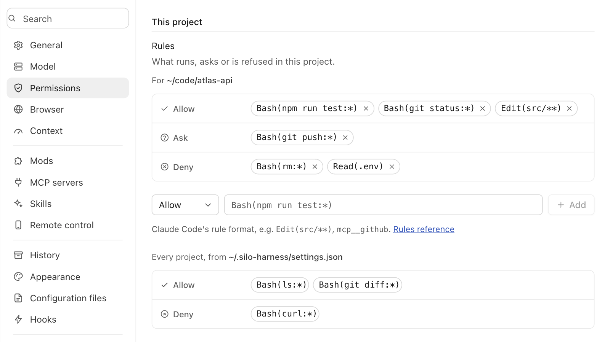
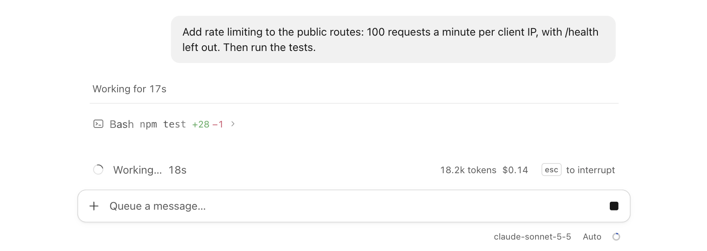
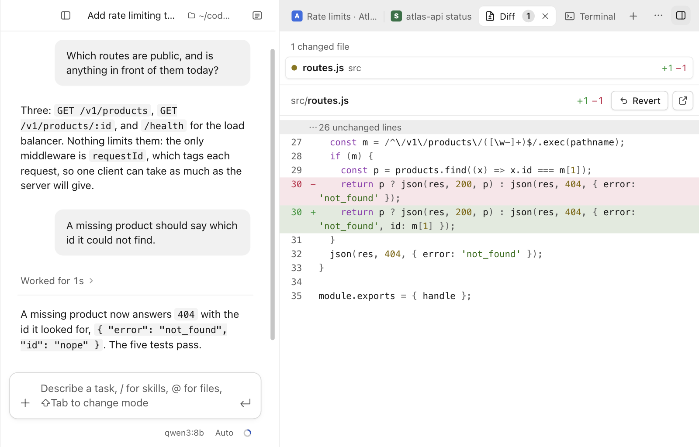
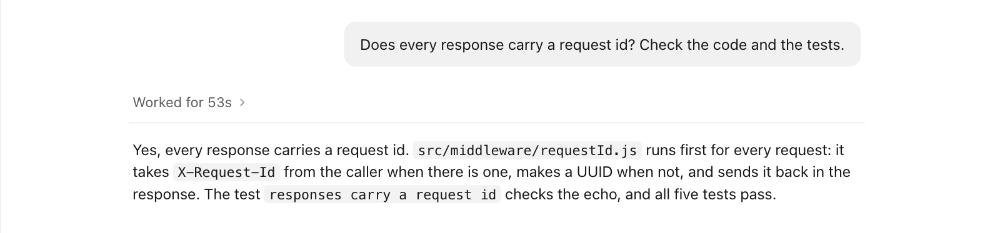
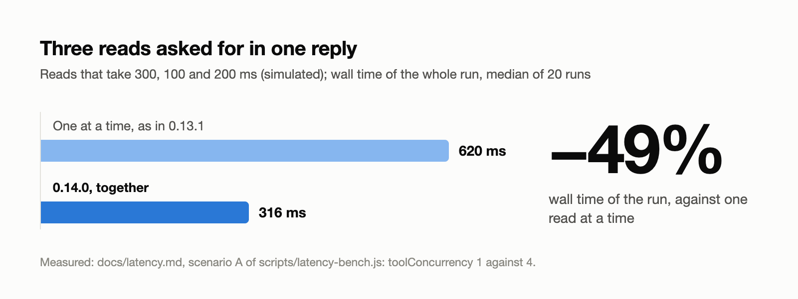
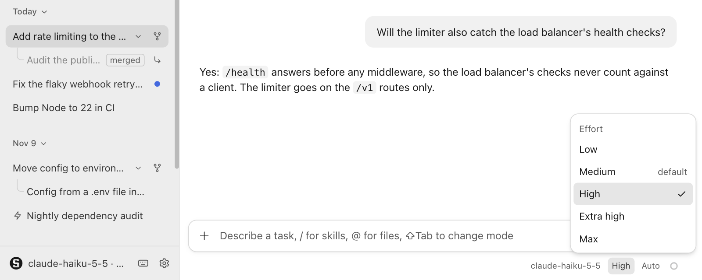
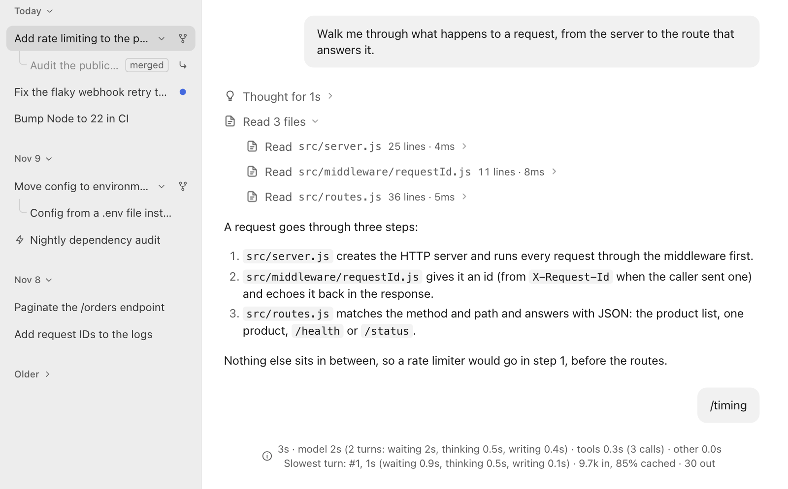
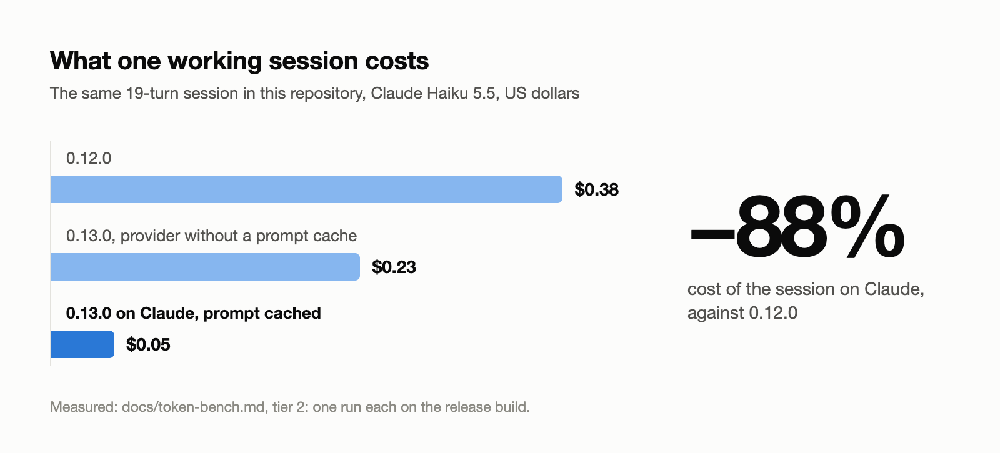
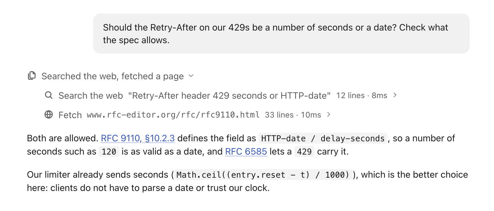
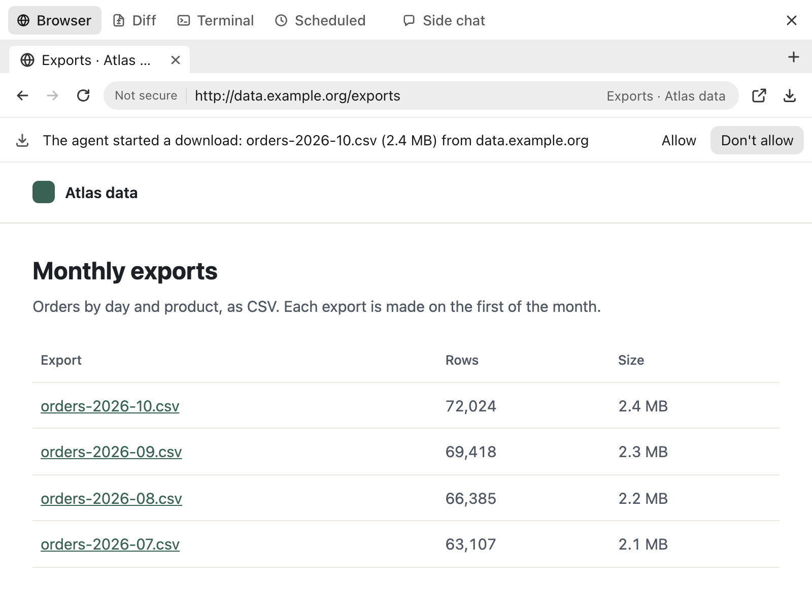

# Changelog

## 0.16.0 — 2026-11-11

Permission rules in Claude Code's format, the session's cost in dollars, and a faster Auto mode safety check on Claude Haiku 5.5.

### Highlights

- **Permission rules.** Allow, ask and deny rules such as `Bash(npm run test:*)` decide what runs without a card, for one project or for all ([details](docs/reference.md#permission-rules)).
  
- **Cost in dollars.** While a run goes on, the status line shows what the session has cost so far, and `/cost` adds the token counts ([details](docs/reference.md#cost)).
  
- **Faster safety check.** With a larger Claude model, Auto mode's check runs on Claude Haiku 5.5: about half the wait at a thirtieth of the cost ([details](docs/reference.md#auto-mode)).

### New

- **Deny and ask rules.** A deny rule refuses in every mode, and an ask rule shows its card in every mode, Bypass included.
- **Path and server rules.** `Read(path)`, `Edit(path)`, `WebFetch(domain:…)` and `mcp__server__tool` rules cover the file tools, web fetches and MCP tools.
- **Your own prices.** `prices` in your settings.json sets the price of any model or provider and overrides the built-in table ([details](docs/configure.md#prices)).

### Improved

- **Cards save rules.** "Always allow" on a card saves a rule that Settings → Permissions lists and removes.
- **Check model fallback.** When your key may not use Claude Haiku 5.5, the session's own model runs the check.

### Security

- **Rules stay yours.** A project's settings file cannot set permission rules or prices, and a write to the files that hold your rules asks in every mode.
- **Allow has limits.** An allow rule never covers a protected path, `sudo`, deleting a critical folder, a browser card or what Plan mode refuses.
- **Guard follows `cd`.** The command guard checks a write in every folder the line may have moved to, and a `../` path counts as outside the project.
- **Deny sees through `sudo`.** A deny or ask rule for a program also matches it behind `sudo` or `doas`.
- **`sudo` stays narrow.** Allowing `sudo` on a card no longer allows what it runs: the command behind it is checked on its own.

### For developers

- **Check model eval.** `scripts/check-eval.js` measures a model as the safety check over 97 labelled actions; one false allow fails it ([details](docs/evals.md)).

### Upgrade notes

- **Saved rules carry over.** Programs, edits and servers you had always allowed read as `Bash(program:*)`, `Edit` and `mcp__server` rules.
- **Check model changed.** Set `autoMode.model` in your settings.json to keep the check on a model of your choice.
- **Substitutions ask.** A command with `$(…)`, backticks or a here-document is no longer covered by a saved program rule and shows its card.
- **Stricter guard.** A command that changes folder and then writes outside the project, or writes through `../`, now shows its card or goes to the check.
- **Variable paths ask.** A write to a path held in a variable (`> "$LOG"`) now shows its card or goes to the check.

### Known issues

- **Slightly stricter check.** In the eval, Claude Haiku 5.5 blocked 4 of 291 actions the larger models allowed; it allowed none it should have blocked.
- **Cost is an estimate.** The figure comes from list prices; your provider's bill is the truth.
- **Rules read text.** `Read` and `Edit` rules do not apply to shell commands such as `cat .env`, and an interpreter can get past a Bash deny rule ([limits](docs/reference.md#permission-rules)).

## 0.15.0 — 2026-11-11

The side pane has one tab strip, a finished turn folds under one line, each session has its own browser tabs, and Auto mode's safety check decides browser actions.

### Highlights

- **One tab strip.** Pages, Diff, Terminal and mod panes are tabs in one strip at the top of the side pane, and a blank tab lists the tools ([details](docs/reference.md#browser)).
  
- **Turns fold away.** A turn that used tools folds under a "Worked for 53s" line once it has its answer; click the line to see the work ([details](docs/reference.md#tools)).
  
- **Browser in Auto mode.** In Auto mode the safety check decides new sites, acts on sign-in pages and page scripts, and shows the card when unsure ([details](docs/reference.md#auto-mode)).

### New

- **Tabs per session.** Each session has its own browser tabs: the pane shows those of the session on screen, and a background session browses in its own.
- **Auto mode learns.** The safety check is given your earlier answers on approval cards; Settings → Permissions → Auto mode lists them, with "Remove", "Forget all" and a switch.

### Improved

- **Live tool line.** While a turn runs, its tool line names the call in flight with a shimmer; opened, it lists the calls one line each.
- **Strip fits its room.** Short of room, long tab titles shorten, quiet tabs become icons, then the strip scrolls and keeps the active tab in view.
- **One pane toggle.** One button at the window's top-right corner shows and hides the side pane.
- **Quieter Terminal pane.** The Terminal pane shows its row of terminals only when there are two or more.
- **Turn times kept.** A stored session keeps each turn's time, so "Worked for" reads the same after a restart.
- **Blocked calls stay visible.** A call Auto mode blocked stays in sight when its turn folds.

### Fixed

- **Passkey requests don't hang.** A page that asks for a passkey is refused at once, and a bar says to choose another way to sign in.
- **Model menu fits.** The model menu under the chat bar stays inside the window and scrolls when its list is long.

### Security

- **Approvals keep their scheme.** A site approval covers only the scheme it was given on: allowing `https://example.com` does not allow `http://example.com` ([details](docs/reference.md#browser)).
- **Script approvals stay narrow.** In Auto mode, "Allow" on a blocked page script covers that script only.

### For developers

- **Mod tabs.** A mod's `tab` pane joins the strip once opened; its × takes it out of the strip and the page keeps running hidden ([details](docs/mods.md)).
- **Turn header classes.** Looks can style `.turn-head`, `.turn-head-btn` and `.turn-hidden`.
- **Learning switch.** `autoMode.learn` in the settings turns recording of your answers on or off (default on).

### Upgrade notes

- **Http sites ask again.** A saved site without a scheme covers https only, plus http on `localhost`, so an http site you allowed before asks once more.

### Known issues

- **No passkeys yet.** Passkeys need a build signed with a Developer ID, and a USB security key is untested.

## 0.14.0 — 2026-11-10

Reads asked for in one reply run together, `/timing` shows where a run's time went, and a pill under the chat bar sets the reasoning effort.

### Highlights

- **Reads run together.** Read-only tool calls of one reply run at the same time: a test run with three reads takes 316 ms instead of 620 ([measurement](docs/latency.md#the-benchmark)).
  
- **Reasoning effort.** A pill beside the model sets how hard the model thinks, from "Low" to "Max"; `/effort` does the same ([details](docs/configure.md#effort)).
  
- **Where the time went.** `/timing` splits the last run into model, tools, safety checks, your approvals and the app's own work ([how to read it](docs/latency.md#timing)).
  

### New

- **Timing log.** `timingLog` in the settings keeps each run's timing in a file, numbers only: no prompts, commands, paths or output ([format](docs/latency.md#the-timing-log)).
- **Read concurrency setting.** `toolConcurrency` sets how many reads run at once, from 1 to 10 (default 4); `1` runs calls one after another, as before.

### Improved

- **Lighter safety checks.** Auto mode's safety check asks each Claude model for the least thinking it allows.
- **Faster AWS reads.** A recognised read-only `aws` command runs as a plain read in every mode instead of waiting for the safety check ([which ones](docs/reference.md#auto-mode)).
- **Timeout hints.** When a command hits its time limit, the agent is told how to raise it, and that macOS has no `timeout` command.
- **Better evidence habits.** The agent batches independent reads, searches narrowly first, and keeps confirmed, likely and unchecked findings apart in its answers.
- **Lighter icons.** Icons draw with a thinner stroke, and the header's pane buttons stay muted until pressed.
- **One "New" menu.** Under Settings → Mods, "Install…" and "From a template…" are items of one "New" button.

### Fixed

- **Sign-ins don't hang.** A sign-in that waits for you, such as `aws sso login`, no longer hangs the shell tool; the agent is pointed to the terminal.
- **Wildcards pass through.** An unmatched wildcard in a command passes through as in bash instead of failing the command.
- **Search keeps partial results.** A `grep` that reaches its time limit returns what it found so far.
- **Paused, not spinning.** A task in progress shows a paused circle once the run has ended, instead of a frozen spinner.

### Security

- **Redirects count as writes.** After "don't change any files", Auto mode's check treats sending a command's output to a file as changing that file.

### For developers

- **Safety-check eval.** `scripts/check-eval.js` scores a model on 97 labelled actions and passes it only with none wrongly allowed ([docs](docs/evals.md)).
- **Answer eval.** `scripts/answer-eval.js` runs the agent on a made-up service with planted traps and grades each answer next to its time and cost.
- **Latency benchmark.** `scripts/latency-bench.js` times seven mock scenarios with reads one at a time and together ([results](docs/latency.md#the-benchmark)).
- **Timing report.** `scripts/timing-report.js` prints where each run in a timing log spent its time.
- **Mod styles ignored.** A mod's `contributes.styles` still loads but is not applied, and the mod shows a note saying so.

### Upgrade notes

- **Themes are removed.** Settings → Mods has no "Theme" tab, the three bundled themes are gone, and a theme you picked is dropped; looks remain.

### Known issues

- **AWS reads are unchecked.** A recognised `aws` read can still print sensitive values; operations known to return credentials go to the safety check.
- **Effort on other services.** Effort is tested on Claude 5 models only; a service that refuses the setting gets the request again without it.

## 0.13.1 — 2026-11-10

Fixes clicks not reaching a page in the Browser pane after a site marked the tab as a window-drag area.

### Fixed

- **Clicks reach every page.** A site can no longer make its tab a window-drag area, which stopped clicks on the Microsoft sign-in page after Teams.

## 0.13.0 — 2026-11-10

Sessions cost a fraction of what they did, the agent can search and read the web, the browser trusts pages less, and MCP servers sign in with OAuth.

### Highlights

- **Sessions cost less.** The same 19-turn session costs $0.05 on Claude Haiku 5.5 instead of $0.38, and $0.24 where the provider has no prompt cache ([measurement](docs/token-bench.md)).
  
- **Search and read the web.** `web_search` finds pages and `web_fetch` reads one as text, without opening the Browser pane and behind the same site approval.
  
- **A more careful browser.** What a page says reaches the agent as data, not instructions, and clicks, downloads, new tabs and the clipboard each get a check.
  

### New

- **Claude Code skills load.** Skills in `.claude/skills` and `.agents/skills`, and commands in `.claude/commands`, load next to the app's own.
- **A skill-writing skill.** `/create-skill` writes a skill, loads it and fixes what the check reports.
- **Skill arguments.** A skill takes what you type after its name as `$ARGUMENTS` or `$1` to `$9`, with a hint in the slash menu.
- **MCP sign-in.** A remote server that needs OAuth shows "Sign in" under Settings → MCP servers and opens your browser only when you click it.
- **Server tool filters.** `enabledTools` and `disabledTools` in a server entry choose which of its tools reach the model.
- **Search backends.** `web_search` uses DuckDuckGo, or Brave, Tavily, Exa or your own SearXNG, chosen under Settings → Browser.
- **Update notice.** A line in the sidebar says when a newer release is out; the daily check can be switched off in Settings.

### Improved

- **Skill problems shown.** Settings → Skills and the skill tool say what is wrong with a skill file instead of skipping it.
- **Instructions from every folder.** `AGENTS.md` and `CLAUDE.md` are read from the project root down to the session folder, and can pull in files with `@path`.
- **A better mod-writing skill.** `/create-mod` covers every kind of mod and checks its work with `mod_check`.
- **Tools sent when needed.** The browser, terminal, sub-session, schedule and mod tools reach the model only once a session needs them, so short sessions send about 40% fewer tokens.
- **Prompt caching on Claude.** Anthropic providers use Claude's own API, which caches the prompt and the conversation from one request to the next.
- **Caching through gateways.** Claude through OpenRouter, Portkey, LiteLLM or Vercel asks for prompt caching, and OpenAI gets the session as its cache key.
- **A steady system prompt.** A mode switch, a rename or a new day adds a short note to the conversation, so providers keep the prompt cached.
- **Fewer cache rewrites.** Where the provider caches, old tool output and screenshots are set aside in batches, so the cached prompt is rewritten rarely.
- **Cache-safe tool groups.** On Claude's own API, loading the browser or terminal tools no longer rewrites the cached prompt.
- **Cached share shown.** The context meter says how much of the last request came from the provider's prompt cache, when the provider reports it.
- **Faster, cleaner search.** grep uses ripgrep when installed, skips `.gitignore`d files and stops after 30 seconds; glob lists recent files first.
- **Smaller search results.** grep cuts each line at 400 characters; grep and glob results stop at 12,000 characters and say how much is left.
- **Cheaper safety checks.** On Claude's own API, Auto mode's check caches your instruction files instead of sending them at full price each time.
- **Retries you can see.** A failed or dropped model call is tried up to 6 times with growing waits, shown on one status line.
- **Cheaper page reads.** `browser_get_text` and `browser_read_page` return 12,000 characters at a time and say where to continue.
- **Servers reconnect themselves.** A remote MCP server that drops is retried 5 times with growing waits, and a crashed local one restarts on its next call.
- **Longer MCP calls.** A server entry can set its own `timeout`, and progress from the server keeps a call alive for up to 10 minutes.
- **Big MCP results saved.** A result over 100,000 characters goes to a private temp file; the model gets its start, its end and the path.
- **MCP server notes.** An MCP server's own usage notes join the prompt, quoted as the server's words and capped at 2,000 characters each.
- **One note per setting.** Stepping through the permission modes, or folders, leaves one line in the transcript, not a stack.

### Fixed

- **Output keeps its end.** Long command output keeps its last lines and always shows the exit code.
- **Edits match exactly.** `edit_file` never joins or splits words to match, says when whitespace differed, and refuses files changed since read.
- **Dropped replies taken back.** Text from a reply that broke off mid-stream is removed before the call is tried again.
- **Cut replies continue.** A reply cut at the output limit continues, and a tool call cut mid-arguments is not run.
- **Repeating calls stop.** A tool call made 5 times with the same result ends the run with a notice.

### Security

- **Nested commands checked.** Commands inside `$(…)`, backticks, `sh -c`, `eval`, `xargs` or `find -exec` get the same checks as the command itself.
- **Read-only means read-only.** Redirections, `VAR=` prefixes and flags such as `sed -i`, `git -c`, `rg --pre` and `sort -o` no longer pass as read-only.
- **Secrets ask before reading.** Reading keys, `.env` files or the app's data with any tool or command asks first, Plan mode included.
- **Protected files always ask.** Writes to `.vscode`, `.mcp.json`, `.envrc`, CI workflows, git hooks, mods or shell start-up files ask every time, except in Bypass.
- **Home-folder scans ask first.** Searching the whole home folder, `/` or `/Users` asks first, so macOS does not raise a row of privacy prompts unasked.
- **Screen, camera, clipboard.** Commands that capture the screen, use the camera or microphone, or read the clipboard ask first.
- **Spotlight for finding files.** The agent finds a file anywhere on the Mac with `mdfind`, which needs no folder access.
- **Pages are data.** What the agent reads from a page arrives in a fence named by the browser, and text you cannot see is left out.
- **Clicks land where checked.** A click on something covered, moved or changed since the agent read the page is refused; another site's frame asks first.
- **Artifacts stay sealed.** An HTML artifact sends nothing out, loads scripts only from cdnjs, jsDelivr or unpkg, and never leaves its page by itself.
- **Downloads ask unless yours.** A download waits for your Allow unless it starts within five seconds of your own click or key press.
- **The clipboard stays yours.** The agent's paste, copy and cut shortcuts in the browser are refused.
- **Tabs named by site.** `browser_tabs` shows a tab's title and address only for sites you allowed; other tabs show their site name alone.
- **Safer page-opened tabs.** A page cannot open a local file, `data:`, `blob:` or blank tab.
- **App ports off-limits.** The agent's browser cannot open the remote-control server or the app's debugging port.
- **No silent identity choices.** No client certificate or Bluetooth device is picked for a page, and HTTP sign-in prompts are cancelled.
- **Careful MCP sign-in.** Sign-in uses PKCE, accepts only https or loopback endpoints, and keeps tokens in a file only you can read.
- **Public sites only.** `web_fetch` refuses private and local-network addresses, re-checks every redirect, and asks for a new site as the browser does.
- **Web text is data.** Fetched pages and search results arrive in a fence, and text imitating the fence is made harmless.
- **Hostile pages stay cheap.** `web_fetch` turns a page built to stall it into text in bounded time and size, and hidden text stays out.
- **Search keys stay put.** A search key is masked in Settings, never shown to the model and cannot be set by a project's settings file.
- **Prompts that explain themselves.** Every macOS permission prompt now says in a sentence what asked for it.

### For developers

- **Skill format defined.** [docs/skills.md](docs/skills.md) sets out the fields, the folders and every problem message.
- **MCP reference.** [docs/mcp.md](docs/mcp.md) covers every server key, sign-in and reconnection.
- **Web reference.** [docs/web.md](docs/web.md) covers both web tools, their safety rules and the `webSearch` setting.
- **Access reference.** [docs/access.md](docs/access.md) lists every folder, connection and macOS prompt the app can cause.

### Known issues

- **Sign-in tested locally.** MCP sign-in is tested against a local OAuth server, not yet against hosted providers.

## 0.12.0 — 2026-11-09

Auto mode now works like Claude Code's, the app says much less, and sessions work in a Silo folder in Documents by default.

### Highlights

- **Auto mode with a safety check.** A second model decides what the rules do not, so read-only commands like `aws sts get-caller-identity` run without a card.
- **Less text everywhere.** Settings, pages, cards and notices keep a label and at most one short line.

### New

- **A Silo folder.** Sessions work in `~/Documents/Silo` by default; the app makes it if it is missing.
- **Choose a folder.** The welcome screen shows the folder's path and a menu of the Silo folder, recent folders and any other.
- **Allow a blocked action.** "Allow" on the line, on the phone or in "Recently blocked" in Settings → Permissions runs it once when the agent tries again.

### Improved

- **Blocks the agent reads.** A blocked action is one quiet line, "Auto mode blocked … · Allow", and the agent gets the reason and carries on.
- **Pauses after repeated blocks.** After 3 blocks in a row or 20 in a session, Auto mode pauses and actions ask again.
- **A quieter welcome screen.** The paragraph and the suggested prompts are gone.

### Fixed

- **Typing a question mark.** `?` in an empty chat box types instead of opening the shortcuts, which stay on ⌘/.

### Security

- **Fails closed.** An error, a timeout or an unclear answer from the check blocks the action; with no model to run it, risky actions ask.
- **Always asks.** `sudo`, and deleting the home folder, `/`, the working directory or a system folder, ask even in Auto mode.
- **Your rules only.** A project's settings.json may not set `autoMode`, so a repository cannot widen what the check allows.

### For developers

- **Auto mode settings.** `autoMode.environment`, `autoMode.allow` and `autoMode.model` describe your setup to the check, add allow rules and choose its model ([configure.md](docs/configure.md#auto-mode)).
- **Block events.** The agent emits `auto_blocked` and `auto_allowed`, and a blocked call is an `auto_blocked` transcript item.

## 0.11.1 — 2026-11-09

Fixes tool results being shown with the wrong tool call when using Ollama models.

### Fixed

- **Tool results with Ollama.** Each result now stays with the call that produced it, including in sessions saved before this release.

## 0.11.0 — 2026-11-09

Pull requests, documents and artifacts now appear as cards in the conversation, and sessions can message each other.

### Highlights

- **Chat cards.** Pull requests a reply names or the agent creates or views, and documents and artifacts it writes, appear as cards like Claude Code's.
- **Messages between sessions.** Each message between sessions, and a sub-session's brief and report, is one muted line in both conversations, such as "Messaged deploy fix ›".

### New

- **Pull request cards.** Each card shows the state, title, files and lines changed, checks and review through your own `gh`, and a click opens the pull request.
- **Document and artifact cards.** Markdown, HTML, PDF and text files the agent writes, and artifacts, share one compact card with "Reveal in Finder" on hover.
- **Allow for this session.** Messaging an unrelated session can be allowed for the rest of this session from its card, and the choice is never saved for the project.

### Improved

- **Waiting plans.** A message or sub-session report reaching a session whose plan awaits your decision waits too, and messages queued when a run ends are never lost.
- **Unread marks.** A session that is not on screen gets the blue dot as soon as a message from another session reaches it.
- **On the phone.** The remote page shows the same message lines and simpler cards: pull requests link to GitHub, documents and artifacts say they are on your Mac.

### Fixed

- **Mod cards.** Turning on a mod the agent just wrote, from its own card, leaves the card saying "is on".

### Security

- **Messages carry no authority.** A message from another session is a request from another agent, never you, and cannot answer approvals, questions or plans or change the permission mode.
- **Scheduled and dreaming sessions.** Sessions a scheduled task or a dream started, and their sub-sessions, can message only their parent and own sub-sessions; anything else is refused at once.

### For developers

- **Prompt origin in hooks.** `UserPromptSubmit` gets `silo_origin`, saying where the prompt came from, and `silo_from_session` with the sending session's id and title.
- **Session messaging tools.** `session_list` says which sessions take messages without your approval, and the sending agent learns whether its message started a run or waits.

## 0.10.0 — 2026-11-09

The Browser pane becomes a browser you can sign in with: its own profile, tabs, sign-in popups, downloads, and an agent that asks before using a site.

### Highlights

- **Its own profile.** The Browser pane's cookies are kept apart from the app's pages, artifacts and mods, and you stay signed in from one launch to the next.
- **Browser tabs.** The pane holds up to 12 tabs with icons and titles; ⌘⇧N opens one, ⌘W closes it and ⌘L goes to the URL bar.
- **The agent asks first.** The first time the agent uses a site, a card asks to allow it once, for the session or always; your own servers never ask.

### New

- **Sign-in popups.** A "Sign in with …" window opens as a card over the pane that you can drag, and the sign-in completes on the page.
- **Cookies and site data.** Turn off "Keep cookies after quitting" to clear site data on quit, or use "Clear browsing data" to sign out of every site.
- **A downloads tray.** Files save to Downloads or a folder you choose, never overwriting another, and a tray lists them with "Open", "Cancel" and "Show in Finder".
- **Find in page.** ⌘F in the pane opens a find bar with a match count; Enter and ⇧Enter move between matches, and Esc closes it.
- **Zoom per site.** ⌘+, ⌘− and ⌘0 zoom the page, each site keeps its level after a relaunch, and a chip in the URL pill resets it.
- **A context menu.** Right-click a page for spelling suggestions, links in new tabs, copying, a DuckDuckGo search, "Save as PDF…" and "Inspect Element"; ⌥⌘I opens DevTools.
- **Blocked popups.** When a page opens too many popups, "A popup was blocked · Show" appears under the URL bar, and "Show" opens it in a tab.
- **Links from the chat.** With "Open links from the chat in the Browser pane" on, a web link in a reply opens in a new tab of the pane.
- **Browser settings.** Settings → Browser gathers the profile, downloads folder, chat links, allowed and always-asking sites, exempt hosts and saved permission answers.
- **Delete all sessions.** Settings → History can delete every session after a confirmation, keeping them in the trash for as long as "Keep deleted sessions for" says.
- **Delete all custom mods.** Settings → Mods can move every mod of yours to the macOS Trash after a confirmation, while built-in and project mods stay.

### Improved

- **A permission bar.** Camera, microphone, location and notification requests ask on a bar under the URL bar, Chrome's way; USB, HID and serial devices are always refused.
- **Connection marks.** A grey lock marks a secure page, and "Not secure" marks a plain HTTP one.
- **On the phone.** The remote page shows the browser's cards worded as on the Mac and can allow a site once or for the session.

### Security

- **Local files ask first.** When the agent opens a file outside the session's folder, it asks first with the full path; `javascript:` and `data:` pages are refused.
- **Sensitive sites.** The agent asks before every action on sign-in, email, bank, broker, wallet, payment and password vault pages, except in Bypass, and you can add sites.
- **Refused in every mode.** The agent cannot type passwords, one-time codes or card details outside your development hosts, solve CAPTCHAs, answer permission requests or proceed past certificate errors.
- **Asks even in Bypass.** A click that looks like a purchase or creating an account, and every download the agent starts, waits for your "Allow" or "Deny".
- **JavaScript by mode.** `browser_eval` shows its code on a card: Ask always asks, Auto asks for code touching cookies, storage, network, passwords or field values, and Plan refuses.
- **Certificate warnings.** An invalid certificate stops the page at "This connection is not private"; "Proceed anyway (unsafe)" lets that site through until the app quits.
- **Project settings.** A project's `settings.json` cannot choose which sites the agent uses without asking.

### For developers

- **A tabs tool.** The new `browser_tabs` tool lists, opens, selects and closes tabs, and every other browser tool acts on the active tab.
- **A reason argument.** `browser_navigate`, `browser_click`, `browser_type`, `browser_press_key`, `browser_eval` and `browser_tabs` take an optional `reason`, which hooks see in `tool_input`.

### Upgrade notes

- **Sign-ins carried over.** The first launch copies your sign-ins to the new profile and says so once; a site keeping its sign-in in local storage may ask again.

## 0.9.1 — 2026-11-09

Fixes in the Browser pane: passwords, one-time codes and card details stay out of what the agent reads, and sites ask before using your camera, microphone, location or notifications.

### Security

- **Hidden field values.** Password, one-time code and card fields read "•••" in everything the browser tools report, so their values never reach the transcript, hooks or exports.
- **Typing without echoing.** `browser_type` still fills such fields but reports only how many characters went in, and the transcript and hooks show "•••".
- **No password screenshots.** `browser_screenshot` is refused while a filled password, code or card field has the focus or shows its value on screen.
- **Sites ask first.** Pages and artifacts ask before using your camera, microphone, location or notifications, or opening links in other apps, and remember answers until the app quits.
- **Yours to answer.** Only you can answer a site's permission request, never the agent; full screen and clipboard copying work without asking.

## 0.9.0 — 2026-11-09

Scheduled tasks and Dreaming get pages of their own, looks are previewed and used without switches, and the rail and mod tabs open and close like the browser.

### Highlights

- **Scheduled and Dreaming pages.** Scheduled and Dreaming open pages of their own in the main column, laid out like Claude Code's, instead of Settings sections; ⌘[ goes back.
- **Looks without switches.** Backgrounds, chat bar looks, conversation looks and themes need no switch: preview any in its Settings → Mods tab, then "Use" applies it.

### New

- **Scheduled tasks.** The Scheduled page lists tasks as cards to search, filter and sort; each task's page has "Run now", an "Active" switch and its run history.
- **Task form and templates.** The "New task" form sets instructions, folder and schedule, from once to a custom cron rhythm, and five templates fill it in for you.
- **Dreaming page.** A card per project shows its mode, last report and waiting suggestions; a "Suggestions" tab applies or dismisses them, and project pages run dreams.
- **New looks and sets.** "New ⌄" on each look tab asks the agent or uses a template, and a set like Hyperspace offers "Use the whole set".

### Improved

- **Rail and mod tabs.** The top bar's first icon or ⌘⇧E toggles the rail, and side pane mod tabs close with × until the ⋯ menu shows them.
- **Lightning bolt and moon.** Sessions from scheduled runs sit with the others by date, with a lightning bolt before the title; a dream's session shows a moon.
- **Agent-written looks.** The chat card for a look the agent wrote offers "Preview" and "Use" instead of "Turn on".
- **Appearance settings.** Settings → Appearance keeps Light, Dark and System, now called "Colour scheme", with rows that open each look tab.

### Security

- **One question, once.** The first "Use" of your own or a project's look asks what its pages may do; built-in looks never ask.

### For developers

- **Opening pages.** `harness.ui.openPage()` opens the Scheduled or Dreaming page, or the "New task" form, and `harness.ui.openSettings()` with those names does too.
- **Look previews.** Looks may name a `preview` picture, `mod_check` says whether one is in use and approved, and a mod's switch covers only its panels and commands.

### Upgrade notes

- **One theme only.** Themes stop stacking: of several themes that were on, the last one applied stays in use, and your chosen looks stay too.

### Known issues

- **Runs need the app.** Tasks run only while the app is open and the Mac awake; a run missed by under a day happens once afterwards.

## 0.8.0 — 2026-11-07

The app moves closer to Claude Code: hooks in its format, its permission prompt, a question card, one quiet line per tool call, and its rail layout.

### Highlights

- **Claude Code hooks.** Hooks in `~/.silo-harness/settings.json` run around tool calls, prompts, compaction and session events in Claude Code's format, so your existing hooks work; see [docs/hooks.md](docs/hooks.md).
- **Claude Code's permission prompt.** The approval card looks like Claude Code's: "Deny" and "Allow once ⌘↵" at the bottom, ⌄ for session or project rules, and Esc denies.
- **Questions from the agent.** The agent can ask you one to four multiple-choice questions, in every mode; answer with a click, 1–4 or your own words under "Other".

### New

- **Hooks in Settings.** Settings → Hooks lists the hooks in effect and where each comes from, plus recent runs with their decision, exit code, time and stderr.
- **Hooks in the conversation.** A hook that blocks something or fails leaves a quiet note, and the status line shows a running hook's status message.

### Improved

- **One line per call.** With "Tool activity" on "Summary", a single call folds too ("Edited a file +3 −1"), and an answered approval stays in its call's row.
- **Rail layout.** Environment shows the folder, repository, branch, provider, model and "Remote control" but no mode row or "Keep awake"; Context follows Claude Code's layout.
- **Footer and status line.** The footer names the model and mode in muted 12 px text, and the status line stays on one line with the side pane open.
- **Quieter Auto mode.** Auto mode says why it stopped in a quiet line on the card, and the mode menu's icons are neutral; only Bypass stays red.

### Security

- **Hooks need your trust.** Hooks from a project's `settings.json` run only after you trust the file, and turning on a mod with hooks says plainly what it allows.

### For developers

- **What hooks can do.** Hooks can refuse, ask about, allow or change a tool call, and send the agent back to work when a run ends.
- **Hooks in mods.** With the `hooks` permission, `harness.hooks.on('PreToolUse', handler)` works like a command hook, and a new `worker` seat runs a hidden page.
- **Mod APIs.** `harness.ui.openSettings(section)` opens Settings at a section, and `harness.project.git()` with `config:read` returns the session folder's repository and branch.
- **Question tool name.** Hooks see the question tool as `AskUserQuestion`.

## 0.7.0 — 2026-11-07

A bundled Glass theme turns the window into frosted, translucent layers in the style of macOS 26, and the website gets the same look.

### Highlights

- **Glass theme.** The bundled Glass theme, off by default, turns panes, bars, cards, menus and dialogs into frosted glass, while the conversation stays plain text.

### New

- **Glass over backgrounds.** With a background in use, the panes are frosted over it while the conversation lets it through at your Dim setting.
- **Light, dark and themes.** Glass works in light and dark, and Paper or Midnight turned on after it recolour the glass through their tokens.
- **Reduce transparency.** With "Reduce transparency" on in System Settings → Accessibility → Display, every layer is opaque in the same colours.

### Improved

- **A glass website.** The project's page has a frosted top bar and glass cards, install blocks and chips in both themes, with no scripts needed.

## 0.6.0 — 2026-11-06

Silo Harness, the new name of Open Harness, works with whichever model service you use and can be set up from a file or the command line.

### Highlights

- **Now Silo Harness.** Open Harness is now Silo Harness, and nothing you have is lost or needs to be moved by hand.
- **Named providers.** Add any number of providers to `settings.json`, each typed as `openrouter`, `portkey`, `openai`, `anthropic`, `groq`, `deepseek`, `together`, `ollama`, `lmstudio` or `openai-compatible`; see [docs/configure.md](docs/configure.md).
- **A command line tool.** The `silo` command lists, adds, removes, tests and switches providers, reads and sets config and runs `doctor`, with or without the app running.

### New

- **Model settings.** Settings → Model and the model button pick a provider and its model, and "Test" says how long one tiny request took.

### Improved

- **Plain errors.** A missing key names its variable; a refused key, unknown model or unreachable address names the provider; the setup strip flags what is missing.

### Security

- **Keys stay hidden.** Keys never reach the window, logs, transcript, mods or command output; Settings shows only "Set (OPENROUTER_API_KEY)" or "Not set".
- **No keys in projects.** A project's `settings.json` cannot hold a key or choose which key is sent where: `apiKey`, `apiKeyEnv`, `portkey.baseURL` and similar fields are ignored.
- **Command line keys.** `silo` takes a key only through `--key-env` or `--key-stdin`, never as an argument.

### For developers

- **Provider entries.** An entry can set its base URL, key variable (`apiKeyEnv`) or key (`apiKey`), model, model list, headers and token limits, and `"provider"` picks one.
- **Command details.** Every `silo` subcommand takes `--json` and `--help` and reports success in its exit code, and the running app applies changes within a second.
- **Renamed variables.** `SILO_HARNESS_CONFIG_DIR`, `SILO_HARNESS_USER_DATA`, `SILO_HARNESS_CLI_LINK_DIR` and `SILO_HARNESS_TERMINAL` replace the `OPEN_HARNESS_…` variables, which still work, and `TERM_PROGRAM` is "Silo Harness".
- **Mods unchanged.** The mod protocol, `mod.json`, CSS tokens and bridge are unchanged, and `harness.info.app.name` says "Silo Harness".
- **Setup for coding agents.** [settings.schema.json](https://brandeispatrick.github.io/silo-harness/settings.schema.json) describes every field, `settings.json` accepts a `"$schema"` key, and coding agents find exact steps in [docs/configure.md](docs/configure.md).

### Upgrade notes

- **Folders move on launch.** The first launch renames `~/.open-harness` to `~/.silo-harness`, leaving a link behind, and moves the data folder to `~/Library/Application Support/Silo Harness`.
- **Failed moves.** If a move fails, it is logged: the config folder keeps its old name, and the data folder starts empty, leaving the old one untouched.
- **Old names still read.** Projects use `.silo-harness/` and `SILOHARNESS.md`, but `.open-harness/`, `OPENHARNESS.md`, `OPENAGENT.md` and `OPENCODER.md` are still read when the new ones are absent.
- **A new command name.** The command is now `silo`; Settings → General → "Command line tool" links it into `~/.local/bin` and removes the old `open-harness` link.
- **Remove the old app.** Once Silo Harness has started once, drag Open Harness to the Trash.

## 0.5.0 — 2026-11-06

The window turns white and grey like Claude Code, 0.4.0's warm look becomes a bundled theme, and Settings → Mods gets a tab for each kind of mod.

### Highlights

- **White and grey.** Surfaces are neutral white and light grey, or near-black in dark, with no warm tint anywhere, as in Claude Code.
- **A tab per kind.** Settings → Mods has a tab for each kind (Mods, Backgrounds, Chat bar, Conversation and Themes), and the look tabs open with their picker.

### New

- **A new icon.** The icon is an S on a grey LED dot-matrix board on a light tile, and the sidebar and empty page draw the same S.
- **Paper theme.** A bundled theme, off by default, brings back 0.4.0's paper surfaces and terracotta accent; turn it on in Settings → Mods.
- **Use the whole set.** A mod with a conversation look, chat bar look and background offers "Use the whole set" on its card in each tab.
- **New and Install everywhere.** "New" and "Install" are on every tab, and the "New" form starts at the tab's kind and can write a starter theme.

### Improved

- **Grey buttons.** Buttons are white with a hairline, the confirming one a grey fill, and dangerous actions use red text and a red hairline.
- **Meaningful colour.** Blue marks links, focus and switches; green and red mark diffs, success and failure; amber marks Auto mode, a filling context and waiting sessions.
- **Same palette everywhere.** The phone page, the bundled mods' pages and the mod kit's `h-btn` use the same palette and buttons.
- **A shorter Appearance.** Settings → Appearance keeps Light, Dark and System with rows to each look tab, which search hits and new-look chat cards also open.

### For developers

- **Theme tokens.** New tokens such as `--button-fill`, `--switch-on`, `--spinner`, `--mark` and `--attention` let a theme colour each role, and `--accent` is the blue; see [docs/mods.md](docs/mods.md).

## 0.4.0 — 2026-11-06

The app can look back over your sessions, once a day or when you ask, and suggest skills, mods and memory for you to apply or dismiss.

### Highlights

- **Dreams suggest improvements.** A dream reads your recent sessions and suggests skills for repeated chores, memory lines for your preferences, or mods for views you keep asking for.

### New

- **It proposes, you decide.** Each suggestion says why, quotes your own words and links its sessions, and anything applied can be reverted.
- **Three modes.** Approve, the default, waits for "Apply" or "Dismiss" on each suggestion; Auto applies them as they come; Plan gathers them into one plan.
- **Daily or on demand.** A daily dream, off until you turn it on, runs at 03:00 or a time you pick, and `/dream` runs one for the session's project.
- **What a dream reads.** Each project with new activity gets a digest of its sessions sized to 40% of the model's context window, at most five projects per run.
- **Where dreams show.** A Dreaming row under Customize shows a dot while suggestions wait, and Settings → Dreaming lists every dream with "Apply", "Dismiss" and "Revert".
- **Dream notifications.** A notification tells you when a nightly dream leaves suggestions.

### Improved

- **Memory lines logged.** A `#` memory line is also recorded in the session's history log.

### Fixed

- **Saved tick placement.** The "Saved" tick in Settings shows above the control, not on a row's description.

### Security

- **Read-only dreams.** A dream can only read and search your sessions and look at the project, with no shell, edits or browser.
- **Where changes go.** The app, never the model, applies suggestions, only into skill, mod and instructions files, and a new mod stays off until you turn it on.
- **Data and tokens.** A dream sends parts of your past conversations to your configured model and uses about as many tokens as a long message per project.

### For developers

- **Dreaming settings.** `settings.json` can set `dreaming.daily`, `dreaming.time`, `dreaming.mode`, `dreaming.skills`, `dreaming.mods` and `dreaming.memory`.

## 0.3.0 — 2026-11-06

The window is rebuilt around reading, mods can restyle the conversation and chat bar as looks, and any session can find another by its name.

### Highlights

- **Folded tool activity.** Each run of tool calls folds into one line, "Read 6 files, edited 2 files, ran a command", unless "Tool activity" is "Every call".
- **Looks for mods.** A mod can restyle just the conversation or just the chat bar, scoped to that region; see [docs/mods.md](docs/mods.md#looks).
- **Sessions by name.** Name another session in plain words, even loosely, and the agent finds it among all your sessions, preferring a related one when several fit.

### New

- **Rename and list sessions.** `/rename` or `session_rename` renames a session without approval, and `/sessions <name>` or `session_list` lists every match, best first.
- **Looks in Settings.** Settings → Appearance → Looks picks a conversation look, a chat bar look and a background, or a whole set from one mod.
- **The Hyperspace set.** A bundled space-opera set brings a starfield that jumps to lightspeed while the agent works, a holographic conversation and a cockpit chat bar.

### Improved

- **A type scale.** Text uses the system font on one scale, 15 px for the conversation down to 12 px for captions, and reply headings stay body-sized.
- **A reading column.** The transcript is one centred column up to 736 px wide, with quiet tool lines, hairline cards and your messages in grey bubbles.
- **A single chat bar.** The chat bar is one bar: a plus, the text and a send or stop button, with model, mode and context in a row below.
- **More air, fewer boxes.** The window gets a 44 px top bar with the folder beside the title, roomier rows and single hairlines between rail sections.

### Fixed

- **Background choice.** Choosing a background from a mod in Settings → Appearance works again.
- **Back-to-back confirmations.** A confirmation right after another, such as deleting twice, stays open until you answer it.

### For developers

- **Kit type scale.** The kit has the type scale (`--fs-ui`, `--fs-small`, `--fs-micro`, `--fs-body`, `--fs-code`), `harness.css` pages use it, and `.h-md` reads like a reply.
- **Attributes for looks.** A look's region carries attributes for a run in progress, light or dark, the permission mode and the mod's settings, so no script is needed.
- **Mod styles and events.** Backgrounds can follow the `pointer` event for parallax, a stylesheet cannot `@import` another, and relative `url()`s point at the mod's files.

### Upgrade notes

- **Compact chat bar.** The bundled "Compact chat bar" mod is now the app's own look and is gone; a profile that had it on ignores the entry.

## 0.2.0 — 2026-11-06

OpenAgent becomes Open Harness: everything beside the chat is now a mod, several sessions run at once, and nothing in a session is lost.

### Highlights

- **Everything is a mod.** Everything beside the chat is a mod, a folder of web files the app shows in a seat and reloads on save.
- **Several sessions at once.** Sessions keep running off screen, each in its own folder, and the sidebar shows which are running, waiting for you or finished unseen.
- **Sub-sessions and forks.** The agent, or you with `/spawn`, `/merge`, `/sessions` and `/send`, can start sub-sessions, read and message them, and merge results back; forks merge too.

### New

- **Mod seats.** Mods fill rail sections, tabs beside the Browser, a strip above the composer or the background, and add styles, slash commands and settings.
- **Built-in mods.** The rail holds Environment, Context, Tasks, Plan, Outputs, Sub-sessions and Skills, and Side chat and Scheduled are tabs beside the Browser.
- **Optional looks.** Dynamic backgrounds, a compact chat bar and a theme come built in, ready to turn on.
- **Mods from the agent.** Ask for a panel and the agent writes it, checks it with `mod_check`, and offers a card to turn it on; edits show live.
- **Scheduled tasks.** A prompt can run once, every N minutes or on a cron rhythm, in a new or existing session; tasks the agent creates need approval.
- **Remote control.** Follow and steer sessions from your phone on a token-protected page the app serves, off until you turn it on.
- **History log.** Every message, tool call and approval goes to an append-only log, so a crash, rewind or compaction loses nothing.
- **Trash and export.** A deleted session can be restored for 30 days, and any session can be exported as Markdown.
- **Images in replies.** The model can show an image inline with `show_image`, tool rows with an image carry a thumbnail, and remote images never load.
- **A settings page.** Settings has sections on the left, one control per row, changes that apply at once, and search across everything.
- **Keep awake.** "Keep awake" keeps the computer awake while a session runs.

### Improved

- **A family sidebar.** Forks and sub-sessions nest under their parent, sessions group by day in collapsible groups, and search looks inside conversations.
- **Task list card.** The task list is a card in the chat, under the latest message.
- **Better compaction.** Old tool output clears first, then older turns are summarised while recent ones and your latest request stay word for word.
- **Context overflow.** A "context too long" error from the provider compacts the session and retries, so the run goes on.
- **Stop means stop.** Stopping a run ends its shell command and everything that command started.
- **Live settings files.** Settings files are validated and re-read while the app runs, and fields a file sets show read-only.
- **Tools sized to models.** Below a 32k-token context window, the scheduling, session and mod tools are left out so small local models keep room; Settings → Context decides.

### Security

- **Safe by construction.** Mods need `network` permission to go online, cannot read other mods' files, answer approvals or change the mode, and project or agent mods start off.
- **Project settings approval.** A project's `.open-harness/settings.json` applies only after your approval, which an edit withdraws, so a cloned repository cannot switch to Bypass or send your key elsewhere.

### For developers

- **The mod protocol.** A `mod.json`, pages in sandboxed frames, one small `harness` object and permissions granted at turn-on make up the protocol; see [docs/mods.md](docs/mods.md).
- **Mod playground.** `node modkit/playground/serve.js` hosts mods outside the app, and Settings → Mods installs from a folder or Git URL, starts one or customises a built-in.

### Upgrade notes

- **Data moves on launch.** Sessions, settings and artifacts move from the old data folder to `~/Library/Application Support/Open Harness` on the first launch.
- **Old files still read.** `OPENAGENT.md` files and `.openagent/skills` folders are still read.
- **New repository.** The repository is now `BrandeisPatrick/open-harness`, and old links redirect.

### Known issues

- **Project config scope.** Project MCP servers and a project's settings file follow the folder of the session on screen, not each background session's.
- **Remote control over HTTP.** Remote control is plain HTTP, so use it on a network you trust; phone browsers are untested beyond a phone-sized window.
- **Rewind and images.** A rewind deletes the stored copy of images shown after that point.

## 0.1.0 — 2026-10-30

First public release, as OpenAgent: an open-source coding agent for the Mac in the style of Claude Code, running local models through Ollama or any provider through Portkey.
