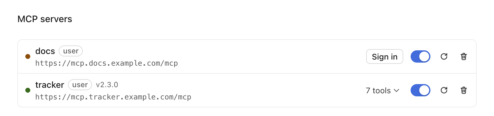

# MCP servers

Servers come from Settings → MCP (stored in the app's `config.json` under `mcpServers`) and from a project's `.mcp.json` (Claude Code's format; off until you turn each one on). The model calls their tools as `mcp__<server>__<tool>`.

## Config keys

```json
{
  "mcpServers": {
    "files": { "command": "npx", "args": ["-y", "@scope/server"], "env": { "KEY": "${KEY}" }, "timeout": 300000 },
    "linear": {
      "type": "http",
      "url": "https://mcp.example.com/mcp",
      "disabledTools": ["delete_issue"],
      "oauth": { "clientId": "abc123", "callbackPort": 8765, "scopes": ["read", "write"] }
    }
  }
}
```

| Key | Transport | Meaning |
| --- | --- | --- |
| `command`, `args`, `env`, `cwd` | stdio | The process to start. `${VAR}` and `${VAR:-default}` expand. |
| `url`, `type` (`http` or `sse`), `headers` | remote | `http` falls back to SSE when the server answers 400, 404 or 405 (an older server); never on 401 or 403. |
| `disabled` | any | Off. |
| `timeout` | any | Milliseconds a tool call may take (1000–86400000; default 120000). Each progress notification from the server starts it again, up to 10 minutes in all (or `timeout`, if longer). Stop cancels a call at once. |
| `enabledTools` | any | Only these tools (exact names) are offered to the model. An empty list offers none. |
| `disabledTools` | any | These tools are never offered. Wins over `enabledTools`. Settings → MCP counts them as "off". |
| `oauth.clientId` | remote | A client registered with the authorization server beforehand. Without it the app registers itself (dynamic client registration). |
| `oauth.callbackPort` | remote | A fixed port for the sign-in callback on 127.0.0.1 (some pre-registered clients need one). Default: a free port. |
| `oauth.scopes` | remote | Scopes to ask for (a list, or one space-separated string). Default: what the server advertises. |

Changing a server's keys reconnects it.

## Project servers and trust

A project's `.mcp.json` servers stay off until you trust each one. Trust covers the entry as written: when its command, arguments, URL, headers or environment change (after a pull, say), the server stops with "Changed since you trusted it." until you trust it again. A `${VAR}` value changing does not count. The app keeps the names in `mcpTrusted` and a SHA-256 of each entry in `mcpTrustedEntries`, both by folder.

## Statuses

| Status | Shown as | What happens |
| --- | --- | --- |
| `connecting` | Connecting… | |
| `connected` | *n* tools | |
| `reconnecting` | Reconnecting | A remote server's connection dropped. The app tries 5 times, waiting 1 s, 2 s, 4 s, 8 s, 16 s (doubling, at most 30 s). A tool call made meanwhile waits up to 60 s, then fails with one line. Then `error` and the Reconnect button. |
| `needs-auth` | Sign in | The server answered 401. Nothing more happens until you click Sign in. |
| `authorizing` | Waiting for browser… | Sign-in is open in your browser. Cancel stops it. |
| `error` | Failed | The reason is shown. A stdio server that exited after it was connected starts again on its next tool call, once; if that fails it stays here. |
| `disabled`, `blocked` | Disabled, Enable | Off, or a project server not turned on yet. |

No reconnection runs for a server you turned off or removed, or after a sign-in failure.

## Sign-in (OAuth)

For remote servers without their own `Authorization` header. It uses the MCP SDK's client auth:



1. You click **Sign in**. The app listens on `127.0.0.1` (a free port, or `oauth.callbackPort`) at `/callback`.
2. It reads the server's protected-resource and authorization-server metadata, registers a client unless `oauth.clientId` is set, and opens the authorization page in your default browser. The request carries a random `state` and a PKCE S256 challenge.
3. The browser comes back to the callback. One request with the right path and `state` is accepted; the page says "Signed in. You can close this tab." and the listener closes. A wrong `state` or an error ends the sign-in. The listener also closes after 5 minutes or on Cancel.
4. The code is exchanged for tokens, the tokens are stored and the server connects.

When the access token expires the SDK uses the refresh token. If that fails the server goes back to `needs-auth`: the app never opens a browser by itself. **Sign out** deletes the server's tokens and client registration; removing the server does too.

Safety: authorization, token and registration endpoints must be `https:` (or `http:` to `localhost`, `127.0.0.1`, `[::1]`); others are refused before any request. Only such URLs are opened in the browser. Tokens, codes and verifiers are never logged, are cut from error text, and never reach the model. The PKCE verifier stays in memory.

## Where tokens are kept

`mcp-auth.json` in the app's data folder (`~/Library/Application Support/Silo Harness/`), mode 0600, written atomically. One entry per server (`<scope>:<name>`) with the server URL, tokens, client registration and discovery result; an entry whose URL no longer matches the server is ignored. Nothing is written until you sign in.

Not the macOS keychain: the build is ad-hoc signed, so macOS would ask for keychain access again after every update. The store is an interface (`TokenStore` in `src/main/mcp-auth.ts`), so a keychain store can be added once the build is Developer ID signed.

## Large results

A text result over 100,000 characters is written in full to `<os tmp>/silo-harness/mcp-results/<session id>/` (folders 0700, files 0600; files older than a day are removed when the app starts). The model gets the path, the first 60,000 and last 10,000 characters and how many were left out, and can read the file in parts. The path comes first, so it survives the 30,000-character cut the conversation view applies to every tool result. Images and other parts are unchanged.

## Server instructions

A server's `instructions` (from the handshake) are kept, at most 2,000 characters: `McpManager.serverInstructions()`. They go in the prompt as quoted notes, 8,000 characters at most for all servers (`serverNotes` in `agent/prompt.ts`). They are untrusted text from the server.
